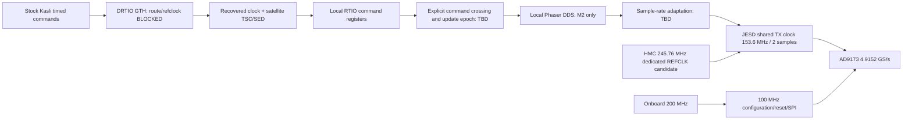

# ALINX / stock Phaser RF comparison — M0, 2026-10-23

**M0 is partial; M1 is BLOCKED. M2–M5 are NOT_RUN.** The user's clarification
selects existing AD9173-FMC-EBZ RevC, not the attachment's AD9172/12.6 GS/s.
No physical device was accessed. Existing AXAU15 synthesis is not a satellite
build or a working RF endpoint. Do not attach the DDS/JESD path before M1 passes.

## Evidence and preserved reference

- `hardware_inventory.yaml`: document/Vivado facts separated from physical unknowns.
- `source_manifest.yaml`: exact local revisions, license-file hashes, and frozen
  Trenz snapshot. JSON syntax is valid YAML 1.2.
- `interface_map.yaml`: inspected source semantics and proposed internal mapping,
  not an implemented compatibility claim.
- `collect_m0.py`: reproducible read-only collection; copies to a separate artifact
  directory, refuses conflicting snapshot overwrite and requires golden bit hash.

The known-good Trenz bitstream `fabric_spi_slow6144.bit` hashes to
`2a3bdd790e7befd69bffdb228b6fc07d9c32b6b736e3817eea45f9a246c4e0be`.
All named source hashes match the historical manifest. 286 local HDL, Python,
Tcl, initialization and selected evidence/log files were copied and readback
hashed under `/srv/codex-hil-data/artiq-zynqmp/artifacts/alinx-phaser-m0-20261023`.
The original lab directory has no required Git identity; its exported source
commit and per-file hashes are recorded instead of inventing a golden commit.
Vivado 2025.2 tool availability is recorded in the existing AXAU15 evidence;
reuse the original build Tcl/log in the snapshot for historical build details.
Do not run its Trenz-specific programming scripts on ALINX. The snapshot is
recovery material, not authorization to reset the working Trenz.

Historical physical evidence: one constant-I stream per DAC, DAC NCO tones
149/151 MHz, sample-rate 4.9152 GS/s and payload amplitude/zero/recovery tests.
This is NOT two simultaneous tones on a single RF output, variable FPGA DDS,
12.6 GS/s operation, deterministic phase, or spectrum-analyzer SFDR/IMD proof.
Startup repeatability remains unqualified. Current powered state was not queried.

## GT and clock feasibility

Exact part `xcau15p-ffvb676-2-i` is Artix UltraScale+ with 12 GTHE4 channels:
manual assigns eight to FMC, four to PCIe. Arithmetic capacity is sufficient
for four JESD TX plus one full-duplex DRTIO lane (5/12). **Accessible DRTIO lane
and clock feasibility are not established by that count.**

JESD candidate uses FMC DP0–3, quad bank225, GBTCLK0 V7/V6, 245.76 MHz,
QPLL1 N100/M2/D2, VCO12.288 GHz, line6.144 Gb/s, shared TX clock153.6 MHz.
Synthesized pin/clock checks passed; routing and physical clock electrical
compatibility did not. Local DAC schematic is revision D while board is RevC:
HMC CLKOUT12 → GBTCLK0 population/driver coupling must be checked on RevC.
Onboard156.25 MHz T7/T6 also lands in bank225, not automatically the PCIe quad.
Do not assume it can clock an arbitrary DRTIO quad or substitute GTGREFCLK.

Local LiteX AXAU15 platform records PCIe lane0 TX AC5/AC4, RX AB2/AB1,
REFCLK AB7/AB6. This is a second source candidate, not a physical adapter audit.
Need exact PCIe–SFP model/schematic, raw lane continuity/direction, AC coupling,
power, TX_DISABLE/LOS, and compatible reference source/routing. A NIC's Ethernet
controller blocks direct raw-GT DRTIO. No native SFP is documented on AXAU15.
The unused FMC channels are occupied connector routes, not spare accessible SFPs.

Practical alternatives if the adapter is a NIC: a verified passive PCIe GT/SFP
breakout with proper power/refclock, or a designed FMC interposer exposing a
spare full-duplex GT without breaking DAC connections. Neither is present proof.
J33/J34 3.3 V HDIO must not be treated as a ready LVDS EEM DRTIO PHY.

## Resource budget

| Resource | Device | Existing JESD/SPI synthesis | M1/M2 reservation status |
|---|---:|---:|---|
| LUT | 77760 | 1622 | satellite/CPU/DDS not synthesized |
| FF | 155520 | 2920 | satellite/CPU/DDS not synthesized |
| RAMB36 tiles | 144 | 0 | firmware/AUX/DDS LUT allocation TBD |
| DSP | 576 | 0 | DDS and any rate converter TBD |
| GTH channels | 12 | 4 | +1 DRTIO proposed; routing blocked |
| GTH common quads | 3 | 1 | DRTIO PLL/refclock allocation TBD |

Source: `../remote-results/20261022/jesd-shared-tx/utilization.rpt`
(local retrieved build evidence).
These are synthesis counts, not routed timing or a full-fit guarantee. Remaining
raw capacity: 76138 LUT,152600 FF,144 RAMB36,576 DSP,8 GTH. Stock MultiDDS shares
one cosine/sine generator and complex-real multiplier per RF channel; this does
not imply a measured DSP count for the future design. A parallel two-sample
MultiToneDDS option exists in current ARTIQ, with different control semantics.
Full resource/timing signoff must await a concrete M1 PHY and M2 rate decision.

## Clock and control boundary

No clock relationship between recovered DRTIO and DAC is proven. An asynchronous
FIFO only moves data; it cannot establish phase or reproducible command latency.
M1 must expose an observable scheduled endpoint with captured timing, TSC/link
state, resets and errors before integration. AXAU15 lacks A53; satellite AUX
management needs a supported softcore/runtime, not copied ZynqMP firmware.
Actual stock Kasli version, device-db routing and reference clock are unverified.

## Phaser compatibility and milestone gate

Inspected stock `rtio/phy/phaser.py` instantiates MiSoC MultiDDS on the ARTIQ
side, packs I/Q, and transmits over EEM. The separate quartiq/phaser repository
contains receiver/interpolation/DUC/DAC gateware (GPL-3-or-later); ARTIQ driver
and DDS integration are a different source (ARTIQ LGPL-3, MiSoC BSD-2).
Removing EEM means relocating DDS and control timing, not replacing JESD.

Stock oscillator FTW is referenced to25 MHz; stock DUC FTW to500 MHz. The
working backend consumes307.2 MS/s, ratio3072/250=1536/125 relative to25 MS/s.
A changed DDS clock with unchanged FTWs gives wrong frequencies. Decide between
rate conversion retaining the original DSP chain and a documented SI-unit
adapter to the sample-parallel DDS; neither is implemented or selected here.
The latter changes machine-unit scaling and latency and is not drop-in register
compatibility. The `phaser_drtio.py` PhaserMTDDS driver is itself different from
stock EEM Phaser and initializes DAC34H84, not AD9173.

Stock init/attenuator/TRF/DAC readback and frame timestamps cannot be fabricated.
A minimal common experiment may use an explicitly adapted frequency/amplitude/
phase/mute interface; stock Kasli and original Phaser remain unchanged. Keep
MIQRO, servo, envelopes and AWG extensions outside this milestone.

## Unresolved physical prerequisites

1. ALINX module/carrier revision, its JTAG adapter identity/own lease and station
   attachment; full matching schematics and actual FMC supply/clock population.
2. PCIe–SFP adapter identification and electrical/clock routing proof above.
3. Stock Phaser variant/hash and stock Kasli version/routing. Existing read-only
   source clones do not prove installed firmware. Coordinate tests explicitly;
   earlier prohibition on accessing Kasli is retained.
4. Trusted analyzer identity/calibration, usable common10 MHz source, calibrated
   attenuation/path losses and a separate baseline Phaser RF connection.

M1 cannot be honestly built/programmed for an unspecified PHY/clock path. No
M2 integration, M3 programming or M4 measurement was attempted across this gate.
